# 잡있으 (job it's)

> 공기업 취업 준비용 개인 비서. GitHub Actions 가 매일 공고를 확인하고, 새 공고가 뜨면 알려주고,
> 시험·공부 일정과 지원 현황을 README 카드로 보여줍니다.

<a href="../../tree/output/generated">




</a>

[공고 게시판](../../blob/output/generated/jobs.md) · [오늘의 브리핑](../../blob/output/generated/briefing.md)

## 하는 일

| 기능 | 내용 |
|---|---|
| **1. 공고 알림 + 게시판** | 잡알리오 공공기관 채용정보 API를 하루 두 번 확인합니다. 새 공고는 디스코드·텔레그램으로 알리고, 원하면 레포 이슈로도 올립니다. 접수 중인 전체 공고는 `jobs.md` 게시판에 모입니다. |
| **2. 시험·공부 일정** | `schedule.yml` 의 시험·발표·접수 일정을 D-30/7/3/1/D-DAY 에 알립니다. 과목별 주간 목표 대비 이번 주 공부량을 진행 바로 보여줍니다. |
| **3. 맞춤 기능** | 관심 기관·키워드·지역·신입/경력 기준으로 공고마다 0~100점 맞춤 점수를 매깁니다. 점수 높은 공고의 마감 임박 알림, 지원 현황 트래커, 자격·어학 만료 경고까지 아침 브리핑 한 장에 묶습니다. |

## 동작 방식

[github-stats-transparent](https://github.com/doongjulim/github-stats-transparent) 와 같은 구조입니다.

```
cron (08:13 / 18:13 KST)
  └─ GitHub Actions
       ├─ output 브랜치에서 state/seen-jobs.json 복원   ← 지난번에 본 공고
       ├─ ./gradlew run
       │    ├─ 잡알리오 API 수집 → 맞춤 점수 → 새 공고 판별
       │    ├─ 브리핑 조립 (공고 · D-day · 공부 · 지원현황 · 스펙)
       │    ├─ 알림 발송 (Discord / Telegram / GitHub Issue)
       │    └─ generated/ 에 jobs.svg · schedule.svg · jobs.md · briefing.md
       └─ generated/ + state/ 만 담아 output 브랜치에 강제 푸시
README 는 output 브랜치의 SVG 를 raw URL 로 임베드
```

- 아침(08:13): 새 공고 + 하루 브리핑
- 평일 저녁(18:13): 새 공고만
- `config/` 를 고쳐 푸시하면 대시보드만 다시 그리고 알림은 보내지 않습니다.
- 첫 실행에는 기존 공고를 전부 "새 공고"로 쏟아내지 않고, 요약 한 줄만 보냅니다.

## 설치 (15분)

1. **API 키**: [data.go.kr 공공기관 채용정보 조회서비스](https://www.data.go.kr/data/15125273/openapi.do) 활용신청 → 마이페이지에서 **일반 인증키(Decoding)** 복사
2. **Secrets** (Settings → Secrets and variables → Actions → *Secrets*)

   | 이름 | 필수 | 값 |
   |---|---|---|
   | `ALIO_API_KEY` | ✅ | 위에서 복사한 키 |
   | `DISCORD_WEBHOOK_URL` | | 디스코드 채널 설정 → 연동 → 웹후크 URL |
   | `TELEGRAM_BOT_TOKEN` | | @BotFather 로 만든 봇 토큰 |
   | `TELEGRAM_CHAT_ID` | | 봇과 대화한 내 chat id |

3. **Variables** (같은 화면 *Variables* 탭) — 새 공고를 이슈(게시글)로도 받으려면 `JOBITS_ISSUES` = `true`.
   GitHub 모바일 앱이 있으면 이슈 알림이 푸시로 옵니다. 별도 토큰은 필요 없습니다.
4. **설정 파일** 수정: `config/profile.yml`, `config/schedule.yml`, `config/applications.yml`
5. Actions 탭 → **job-its** → *Run workflow* 로 첫 실행. 이후는 자동.

> ⚠️ 레포가 public 이면 `config/` 와 output 브랜치(브리핑 포함)도 공개됩니다.
> 개인 일정·스펙을 숨기고 싶다면 private 레포로 쓰세요. 대신 프로필 README 임베드는 안 됩니다.

## 설정 파일

| 파일 | 내용 |
|---|---|
| `config/profile.yml` | 목표, 서버 필터(NCS·고용형태), 맞춤 점수 기준, 보유 스펙과 유효기간 |
| `config/schedule.yml` | 시험·발표·접수 일정, 과목별 주간 공부 목표(기간 지정 가능) |
| `config/applications.yml` | 지원 현황 (관심 → 서류 → 필기 → 면접 → 최종합격/불합격) |
| `config/study-log.csv` | 공부 기록. 직접 편집하거나 `log` 명령으로 추가 |

### 맞춤 점수

| 조건 | 점수 |
|---|---|
| 관심 기관 (부분 일치) | +40 |
| 공고 제목에 키워드 | +20 |
| 선호 근무지 | +15 |
| 신입/경력 구분 일치 | +15 |
| 정규직 | +10 |

`notifyMinScore`(기본 30) 이상인 새 공고만 개별 알림을 보냅니다. 나머지는 게시판에서 확인합니다.

## 로컬에서 돌리기

```bash
./gradlew run --args="demo"                    # API 키 없이 샘플 공고로 결과물 생성 → generated/
./gradlew run --args="log TOEIC 90 RC 파트5"    # 오늘 공부 기록 추가
export ALIO_API_KEY=...
./gradlew run --args="raw"                     # API 원본 응답 확인
./gradlew run                                  # 실제 실행 (알림 채널은 환경변수로)
./gradlew test
```

처음 키를 받으면 `raw` 로 응답을 한 번 보세요. 기관명(`instNm`)과 공고 제목(`recrutPbancTtl`) 외의 필드명은
코드정의서 기준 추정값입니다. 다르면 `ParseRecruitmentService` 의 `F_*` 상수만 고치면 됩니다.

## 구조

```
src/main/java/com/dongju/jobits
├─ JobItsApp                 명령 분기 (run | demo | raw | log)
├─ RunDailyPipeline          수집 → 맞춤 → 새 공고 → 브리핑 → 알림 → 렌더 → 상태 저장
├─ config/                   YAML·CSV 설정 로딩 (LoadConfigService, Profile, ScheduleConfig …)
├─ job/                      잡알리오 API 클라이언트, RecruitmentSource(API/픽스처),
│                            MatchRecruitmentService(맞춤 점수), DetectNewRecruitmentService
├─ schedule/                 FindUpcomingEventService(D-day), SummarizeStudyProgressService
├─ career/                   CheckSpecStatusService, SummarizeApplicationService, BuildDailyBriefingService
├─ notify/                   Notifier 인터페이스 + Discord / Telegram / GitHub Issue / Console,
│                            NotificationDispatcher(채널별 실패 격리)
├─ render/                   SVG 카드, 게시판·브리핑 마크다운, 메시지 문구
└─ state/                    SeenRecruitmentStore (본 공고 키, 최근 3,000개)
```

- 새 알림 채널(카카오톡, 이메일 등)은 `Notifier` 만 구현해서 `NotificationDispatcher.fromEnvironment` 에 등록하면 됩니다.
- 공고 소스를 늘리려면(예: 워크넷, 사람인) `RecruitmentSource` 를 구현합니다.
- 테스트 27개: 맞춤 점수, 새 공고 판별, D-day, 주간 집계, 스펙 만료, 알림 실패 격리, 파이프라인 전체 흐름.

## 다음에 붙일 것

- [ ] 공고 상세(지원자격·전형) 파싱해서 내 스펙과 자동 대조
- [ ] 이슈에 댓글로 `/지원` 남기면 `applications.yml` 에 자동 추가 (issue_comment 트리거)
- [ ] 주간 리포트: 공부 시간 추이 SVG
- [ ] 관심 기관의 작년 공고 시기 기반 "곧 뜰 공고" 예측

## Credits

Actions + output 브랜치 + 투명 SVG 구조는
[jstrieb/github-stats](https://github.com/jstrieb/github-stats) →
[rahul-jha98/github-stats-transparent](https://github.com/rahul-jha98/github-stats-transparent) 에서 가져왔습니다.
공고 데이터: 재정경제부 공공기관 채용정보 조회서비스(공공데이터포털).
